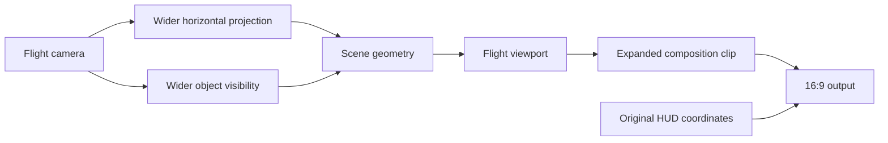

# Prophecy widescreen and 60 FPS: release 0.1 report

Date: 2026-11-08.

## Result

The supported Steam Enhanced build ran with a wider flight view and a 60 FPS limit.
The wider view preserved the vertical view and HUD scale.
A carrier placed outside the original left boundary appeared in the added screen area.

The temporary test displayed roughly 60 FPS, with captured counters of 59 and 61 FPS.
After installation through a renderer proxy, the game log reported that the native hooks loaded.
The owner confirmed that the installed native patch worked after taking control of the normal launcher.

These results cover a short flight test and one left-edge carrier position.
They do not establish full campaign compatibility, every targeting mode, or consistent frame pacing.
Release 0.1 retains those limits.

## Starting point and prior work

The initial request covered widescreen flight and 60 FPS in Wing Commander Prophecy.
The owner's comparison of the installed anniversary editions supplied this baseline:

| Game | Owner's observed behavior |
| --- | --- |
| Wing Commander III | Widescreen and 60 FPS |
| Wing Commander IV | 4:3 and 60 FPS |
| Wing Commander Prophecy | 4:3 and approximately 32 FPS |

The Prophecy installation already contained HCl's enhancement DLL and OpenGL renderer version 1.4.
Installing an older general graphics upgrade would have duplicated existing components.
The missing work was the flight view and its frame limit.

gr1mre4per released an [FPS utility in March 2015](https://www.wcnews.com/chatzone/threads/prophecy-frame-rate-boost.27791/).
It changed a floating-point frame limit in the executable.
The utility's recognition bytes and Prophecy patch location matched the installed Enhanced executable.
The change applied here performed the equivalent write without running that utility's interface.

The same developer [described the widescreen visibility problem in October 2025](https://www.wcnews.com/chatzone/threads/wing-commander-prophecy-unlimited-hd-movie-support.28146/post-420047).
Widening the rendered image alone left objects disappearing before they reached the new screen edge.
The engine's original visibility boundaries therefore needed the same horizontal expansion as the camera.

The [March 2026 frame-rate discussion](https://www.wcnews.com/chatzone/threads/wing-commander-prophecy-unlimited-hd-movie-support.28146/post-420919) identified 50–60 FPS as a useful range.
It described turret, asteroid and audio faults at higher rates.
This release targets 60 FPS and makes no claim for 85, 120, or unlimited FPS.

## WC3 and WC4 as references

Matt Wells' original-engine enhancement patches provided useful design references:

| Reference | Source revision inspected | Useful behavior |
| --- | --- | --- |
| [WC3 Enhancement Patch](https://github.com/mattwells77/Wing_Commander_III_Enhancement_Patch/tree/60200d617f9c5fa01ab87c48469ad85de2b48226) | 0.14.7 | Separate flight rendering, fitted interface and cockpit clipping |
| [WC4 Enhancement Patch](https://github.com/mattwells77/Wing_Commander_IV_Enhancement_Patch/tree/f2bd1b71457d4e2fcae956c18b7f6cec34f271fa) | 0.9.10 | Coordinated camera dimensions, render bounds, targeting and small-display exceptions |
| [WC4 alternate renderer](https://github.com/mattwells77/Wing_Commander_IV_Enhancement_Patch/tree/1f2dd0fa37f9eddfef6bbc634aec85c0afe967e4) | 0.9.4 | Earlier implementation of the same widescreen presentation choice |

Those patches established a design pattern, not transferable Prophecy addresses.
Prophecy used a different engine and graphics interface.
Its own camera and renderer paths required separate analysis.

The WC4 configuration already requested a wider flight view.
Its observed 4:3 presentation was not diagnosed or changed during this work.

## Frame-limit change

The Enhanced executable initialized its maximum frame rate with the floating-point value `32.0`.
The clock routine measured elapsed time and slept when it ran ahead of that limit.
The existing utility identified the same initialization site.

| Field | Value |
| --- | --- |
| Recognition offset | `0x7DE91` |
| Recognition bytes | `FF 68 00 00 80 40 68` |
| Floating-point value offset | `0x7DE98` |
| Original bytes | `00 00 00 42` = `32.0` |
| Patched bytes | `00 00 70 42` = `60.0` |
| Actual changed bytes | One byte, at `0x7DE9A` |

The executable kept its original size.
A full-file hash identified the expected result before installation.
The owner confirmed the 60 FPS result in flight.
No original executable is included in the repository or release archive.

## Widescreen diagnosis

The game created a 2560×1440 output but retained a logical 640×480 flight camera.
The renderer scaled that camera by three and added a 320-pixel horizontal offset.
That produced a centered 1920×1440 view and black bars at both sides.

The camera contained projection coefficients and six visibility planes.
A visibility plane is a boundary used to reject unseen objects.
The projection and those boundaries came from the same camera calculation.

| Engine address | Observed role |
| --- | --- |
| `0x004105C0` | Calculates projection coefficients and visibility planes |
| `0x004107E0` | Sets the camera rectangle and recalculates those values |
| `0x00410BD0` | Tests object bounds against the visibility planes |
| `0x00410A00` | Base camera draw path |
| `0x0041C4D0` | Earlier DustCamera draw path used by flight |

The widened logical camera used horizontal bounds `-107` through `746` at the tested resolution.
Its center stayed at `(320, 240)` and its half-width increased from 320 to 427.
The horizontal projection coefficient changed from about `1.732051` to `1.298024`.
The horizontal field of view increased from about 60° to 75.22°.

The vertical coefficient and projected pixel scale stayed unchanged.
The left and right visibility planes changed with the horizontal coefficient and retained unit-length normals.
The rounded logical width produced a 2562-pixel viewport, with one excess pixel clipped at each side of the 2560-pixel output.

Small cockpit cameras did not meet the full-view rectangle condition and remained unchanged.
Camera fields returned to their saved values when each draw call ended.
Nested calls did not apply the expansion twice.

## Why the first trials remained boxed in

The first temporary trial changed the base camera and its visibility boundaries.
The second also covered the earlier DustCamera path and the immediate viewport calls.
Both reached the intended camera data, but the final image retained its black bars.

Runtime observations then showed a separate final clipping rectangle of `[320, 0, 1920, 1440]`.
The HDR composition path used this rectangle after camera rendering.
HDR composition combines intermediate rendered images for the final display.

The renderer kept both current clipping bounds and accumulated bounds for that composition.
The successful trial expanded the final clip when the current camera or accumulated frame bounds described the wider view.
It retained the interface's original coordinate scale.

The successful temporary trial displayed extra scenery across the full output width.
The carrier test then supplied a concrete object in the added left-hand area.
After the temporary test ended, direct reads showed both cameras back at their original rectangles, coefficients and visibility planes.

## Standalone implementation

The native patch replaced `gl_00007.dll` with a small proxy, a DLL that loads and calls the existing renderer.
The original renderer remained beside it as `gl_00007_original.dll`.
The proxy exported the original three entry points: `InitGl`, `CreateGl` and `DestroyGl`.

The patch changed the two camera virtual draw pointers and the original renderer's imported `glViewport` and `glScissor` pointers.
It preserved the byte returned by each camera function.
It also pinned the proxy in memory for the process lifetime because the camera pointers referred to its code.
Compatibility checks ran before those pointers changed.

The release installer checks full input hashes before it changes any game file.
It preserves the executable and renderer in `wcpwide-backup` and uses atomic file replacement.
Removal restores the saved executable state, including an existing 60 FPS modification.
The original renderer and all game data remain local to the user's installation.

## Validation

| Check | Result and scope |
| --- | --- |
| Build | MSVC x86, optimized static runtime, warning level 4 with warnings treated as errors |
| Source correspondence | A fresh source build matched all DLL bytes after normalizing only COFF and debug-directory timestamps |
| Horizontal visibility | Geometry self-test accepted a 35° point rejected by the original 30° half-angle |
| Vertical view and scale | Native self-test retained the vertical and pixel-projection fields |
| Camera restoration | Native self-test restored the original bytes and excluded nested and small-display calls |
| Renderer loading | A 32-bit host loaded the proxy, checked export names and ordinals, and called the original factory and destructor |
| Unsupported host | The loader test disabled hooks in an unsupported host without reading the fixed game addresses |
| Temporary flight | Full-width scenery observed at 2560×1440, with a displayed counter around 60 FPS |
| Left-edge object | Carrier hull appeared beyond the original left boundary at the owner's chosen test position |
| Native installation | Installed DLL hash matched the staged patch, and the native log reported enabled hooks |
| Native flight | Owner confirmed that the installed patch worked after the normal launcher handoff |
| Portable installer | Stock and existing-60-FPS install/remove cycles, repeat install, proxy adoption, unsupported-input refusal and changed-file refusal |

The release DLL is the exact 89,088-byte binary used for the confirmed native test.
Source rebuilds can have different linker metadata.
No game process or temporary instrumentation is required to use the release.

## Supported file identities

| File | SHA-256 |
| --- | --- |
| Original Enhanced executable | `442A4668367F65FCCFAB7A6791B5BD4C2747F24DE1D454CDCBE6A276F060432D` |
| Matching 60 FPS executable | `4EDE5E11844B0B0AD7DFC8FCDA17A472C7B094D8C3BE355457E4C167F17CE71D` |
| Original OpenGL renderer | `6656D72AAB506B3D2041FAD4330E5BA4B106034A1B6F283FD1C76E2700204020` |
| Release 0.1 proxy | `EF9CACCE9762989604FC8B55119C3F947A55ABEF546ECFC8C52BDC15B21C15F6` |

## Remaining limits

Testing did not cover a complete campaign, every cockpit, all targeting modes, navigation, every video mode, or repeated renderer reinitialization.
Other resolutions, GOG, retail editions and Secret Ops remain unvalidated.
The installer refuses files outside the supported identities.

The displayed frame counter supplied the frame-rate observations.
There was no instrumented frame-pacing study or exhaustive simulation-speed comparison.
The carrier result covers one left-edge position and does not prove every clipping case.

Release 0.1 provides a tested starting point with reversible installation and explicit compatibility limits.
Bug reports need the game edition, file hashes, output resolution, `wcpwide.log`, and steps that reproduce the fault.
Do not attach game executables, original DLLs, assets or saved games to a public issue.
